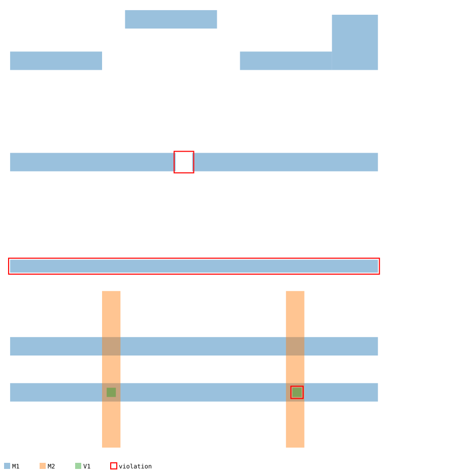
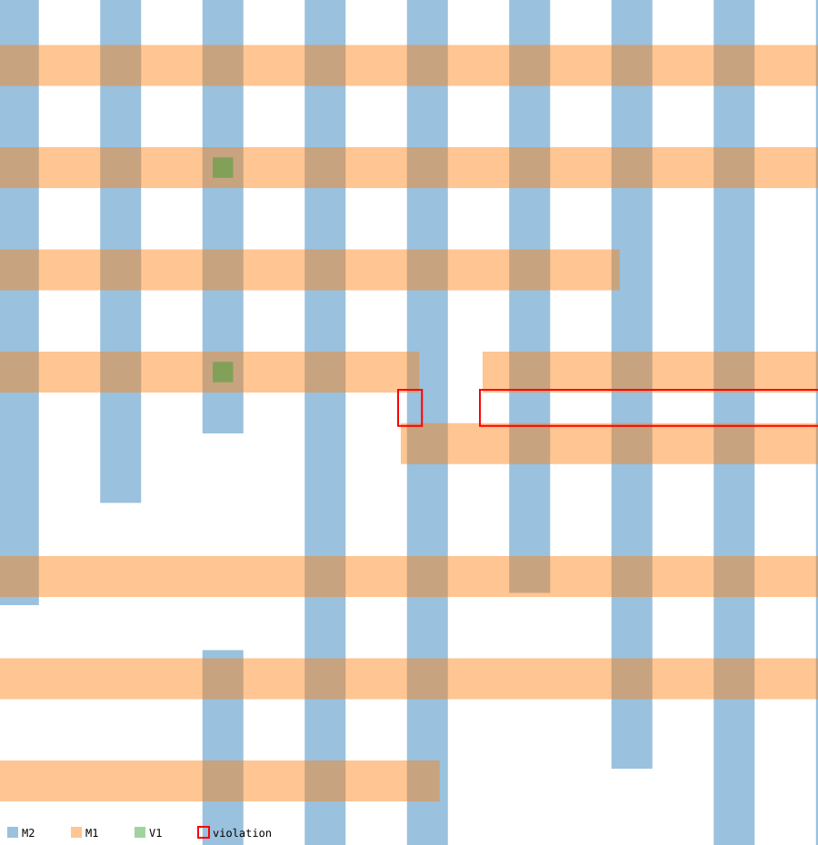

# minidrc — a layout design-rule checker in C++

A small physical-verification tool. It reads a chip layout (axis-aligned rectangles on named layers) and a rule deck, then reports every **minimum width**, **minimum spacing** and **via enclosure** violation. It can draw any violation as an SVG picture.

Comparing every pair of shapes is O(n²). minidrc's grid and sweep-line algorithms check a 4.1-million-shape layout in about 1.3 seconds on one core, where the all-pairs version would take an estimated two hours. All three algorithms are verified to report identical violations.



*`examples/small.txt`: a 14-wide wire (width), two wire ends 18 apart (spacing), and a via whose M2 margin is 3 (enclosure), outlined in red. Near-misses such as an exactly-30 gap, a diagonal corner pair and touching shapes are correctly left alone.*

## Features

- **Three rule types:**
  - `width L w`: every shape on layer L is at least w wide.
  - `spacing L s`: unconnected shapes on L are at least s apart, measured as true Euclidean distance.
  - `enclosure V M e`: every shape on V sits inside a shape on M with at least e of margin on all sides.
- **Three spacing algorithms** that must agree exactly:
  - naive all-pairs (the baseline)
  - a uniform grid / spatial hash, with OpenMP
  - a sweep line with an ordered active set
- **Integer geometry throughout.** Distances are compared as `dx² + dy² < s²`, with no square roots or floating-point rounding in the decision.
- **A synthetic layout generator.** It builds two-metal routing (horizontal M1, vertical M2, vias at crossings) at any size and injects four kinds of known defects.
- **SVG rendering** of any violation, or of a whole small layout.

## Build and run

Requires CMake ≥ 3.16 and a C++20 compiler. OpenMP is used if available.

```bash
cmake -S . -B build -DCMAKE_BUILD_TYPE=Release
cmake --build build -j
ctest --test-dir build --output-on-failure        # 213 checks

./build/minidrc check examples/small.txt examples/rules.txt --svg small.svg --svg-full
./build/minidrc gen   --rects 1000000 --seed 1 --out layout.txt
./build/minidrc check layout.txt examples/rules.txt --show 5 --svg v.svg --svg-at 0
./build/minidrc check layout.txt examples/rules.txt --algo sweep
./build/minidrc bench layout.txt examples/rules.txt --threads 8
```

`check` exits with 0 when the layout is clean and 2 when there are violations, so it can gate a CI pipeline.

### File formats

```text
# layout: LAYER x1 y1 x2 y2   (integer database units, x1 < x2, y1 < y2)
M1    0  250  180  270
M1  198  250  400  270
V1  307    5  317   15

# rules
width     M1 20
spacing   M1 30
enclosure V1 M1 5
```

## How it works

### Spacing: what counts as a violation

For two shapes on the same layer, take the gap along each axis, `dx = max(0, b.x1 − a.x2, a.x1 − b.x2)` (and similarly `dy`). Then:

- **Touching or overlapping shapes** (`dx = 0` and `dy = 0`) are one connected polygon, so the spacing rule does not apply.
- **Otherwise** the distance is the true Euclidean distance between the closest points, `sqrt(dx² + dy²)`. It is compared as integers, `dx² + dy² < s²`.

The Euclidean metric matters at corners. Two shapes offset diagonally by `dx = dy = 25` are 35.4 apart, which passes a 30 rule, even though both projections are closer than 30. A "square" (Chebyshev) metric would flag them. Real rule decks can choose the metric per rule. `examples/small.txt` and the tests include this case.

### Finding candidate pairs: bloat and intersect

Two shapes can only violate spacing `s` if `dx < s` and `dy < s`. That is the same as saying *shape b intersects shape a's box grown ("bloated") by s on every side*. So every algorithm runs the same cheap box test first, and computes the exact distance only for pairs that pass. The algorithms differ only in how they avoid even *looking* at far-away pairs.

### 1. Naive

Every pair on the layer: n(n−1)/2 box tests. At 400k shapes per layer that is 80 billion pairs per layer.

### 2. Uniform grid (spatial hashing)

- **Build.** Cover the layer's bounding box with square cells and list each shape in every cell it overlaps. The cell contents are stored **CSR-style** in two passes:
  1. count the shapes per cell
  2. prefix-sum the counts into offsets, then fill one flat array

  A query then reads contiguous memory, and there is one allocation instead of one vector per cell.
- **Query.** For each shape `a`, visit only the cells overlapping `a` bloated by `s`. Any shape closer than `s` must be listed in one of those cells.
- **Each pair once.** A pair is checked only from the shape with the lower index (`j > i`). A per-thread "last checked by" stamp array skips a candidate that shows up in several cells. Shapes are processed in parallel with OpenMP, and each thread keeps its own violation list, merged at the end.

**Choosing the cell size** is the interesting tradeoff:

- Cells that are too small make a long wire appear in many cells, which costs memory and repeated visits.
- Cells that are too large hold many shapes, which means more false candidates.
- The **worst case** is every shape landing in one cell, which degrades back to O(n²).

The default cell size is `sqrt(mean width × mean height)`, never smaller than the rule. Measured on the 1M-shape layout (20×~1000 wires), one thread:

| cell size | exact distance checks | spacing time |
|---:|---:|---:|
| 50 | 4.2M | 0.27 s |
| **145 (auto)** | **3.2M** | **0.31 s** |
| 400 | 8.1M | 0.28 s |
| 1,000 | 22.6M | 0.37 s |
| 3,000 | 104.5M | 0.87 s |

At small cell sizes, the cost of listing a long wire in many cells offsets the fewer candidate checks. Past ~400, the candidate count grows quickly.

### 3. Sweep line

- **Sort and sweep.** Sort the shapes by left edge and sweep a vertical line from left to right.
- **Active set.** Keep the shapes whose right edge is within `s` of the line in a `std::set` ordered by `y1`. A min-heap of right edges evicts shapes once they are `s` or more behind the line, since they can never be close to anything further right.
- **Bounded-height query.** For a new shape `a`, a neighbour `b` needs `|gap in y| < s`. No shape is taller than `hmax`, so `b.y1` must lie in `[a.y1 − hmax − s + 1, a.y2 + s − 1]`. That range is found with `lower_bound`, so only true y-neighbours are visited. Each pair is checked once, when the second of the two shapes is inserted.
- **Transpose for vertical layers.** The `hmax` trick works when shapes are short in y. For a layer of vertical wires, x and y are swapped first, so the sweep always runs along the long axis.

The sweep visits far fewer candidates than the grid (1,540 vs 3.2M on the 1M layout). It is still somewhat slower in wall-clock time because every insert and erase is an O(log n) balanced-tree operation with pointer chasing, while the grid scans flat arrays. The sweep is also inherently sequential.

### Enclosure

For each via, a grid over the metal layer returns the metal shapes it touches. The via passes if one of them contains it with margin ≥ e on all four sides. Otherwise the report gives the best partial margin, or "not covered" if no metal touches it.

### Generator

`minidrc gen` builds M1 wires on horizontal tracks and M2 wires on vertical tracks: width 20, pitch 50 (so 30 of space), random lengths and gaps. It places 10×10 V1 vias where wires cross, centred to give exactly 5 of enclosure. That layout is clean under `examples/rules.txt`; a test checks this. It then injects defects at a chosen rate:

- thinned wires
- wires pushed 15 toward the next track
- wire ends placed closer than 30
- vias shifted off-centre

Every thinned wire must be reported as exactly one width violation.



## Benchmarks

Spacing-check time on generated layouts, Intel Xeon @ 2.1 GHz, **single core** (the build container had one core). Run `scripts/run_benchmarks.sh` to regenerate the table on your own machine; the multi-threaded grid column will then scale with cores. For layers over 50k shapes, the naive time is extrapolated from a 50k-shape sample, which is safe because its cost is exactly quadratic.

| shapes | violations | naive all-pairs | sweep line | grid | best speedup |
|---:|---:|---:|---:|---:|---:|
| 10,605 | 41 | 0.06 s | 0.003 s | 0.003 s | 22× |
| 104,616 | 322 | 5.57 s | 0.039 s | 0.026 s | 212× |
| 1,040,239 | 3,127 | ~494 s (est.) | 0.50 s | 0.28 s | ~1,800× |
| 4,155,730 | 12,379 | ~2.2 h (est.) | 2.69 s | 1.32 s | ~6,000× |

The speedup grows with size because the naive cost is quadratic while the grid and sweep are close to linear. At 1M shapes, all-pairs needs 161 billion box tests, while the grid needs about 3 million exact checks.

## Tests

`tests/test_main.cpp` (no external framework) covers:

- geometry helpers (gaps, a 3-4-5 distance, edge and corner touching)
- spacing exactly at the rule (legal) and one unit under (violation), for every algorithm
- Euclidean corner-to-corner: 25/25 is legal, 20/20 is a violation
- touching and overlapping shapes, and layer isolation
- width and enclosure, including "not covered" and partial margins
- `examples/small.txt` gives exactly one violation of each kind with every algorithm
- parser errors
- **40 random layouts** mixing horizontal wires, vertical wires, small shapes and big blocks: naive, grid (1 and 4 threads), sweep, and a grid with a random cell size must all report identical violations
- generated layouts: zero violations without defects, and each injected thin wire found

## Limitations and next steps

- **Rectangles only, checked shape by shape.**
  - Real layouts are polygons, and DRC first merges overlapping shapes on a layer into polygons. Width is then measured on the merged shape: two overlapping 15-wide rectangles side by side form a legal 30-wide wire, which this tool would flag.
  - Enclosure is checked against single metal rectangles, not their union.
  - Notches (spacing within one polygon) and minimum area are not checked.
- **No context-dependent rules.** Real decks have spacing that depends on wire width or parallel run length, end-of-line rules, and density rules.
- **No connectivity or LVS.** LVS (layout vs. schematic) extracts the circuit from the layout and compares it to the netlist. DRC only checks geometry.
- **Possible extensions:** a polygon merge step (a scanline over edges), an R-tree or KD-tree index for very non-uniform shape sizes, a parallel sweep that cuts the layout into vertical strips with an overlap of `s`, and hierarchical checking (check a repeated cell once, not every instance).

## Layout

```
src/layout.{hpp,cpp}   rectangles, layers, file parsers, gap/distance helpers
src/drc.{hpp,cpp}      Grid index, width/spacing/enclosure checks, naive/grid/sweep
src/gen.{hpp,cpp}      synthetic layout generator with injected defects
src/svg.{hpp,cpp}      SVG rendering of violations
src/main.cpp           CLI: check, bench, gen
tests/test_main.cpp    tests
examples/              rules.txt, small.txt
docs/                  pictures used in this README
scripts/               run_benchmarks.sh
```
